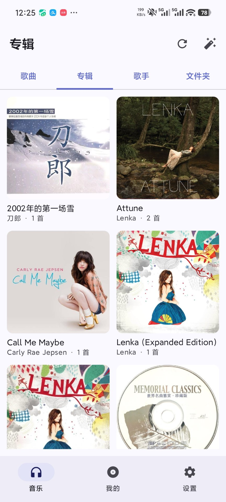
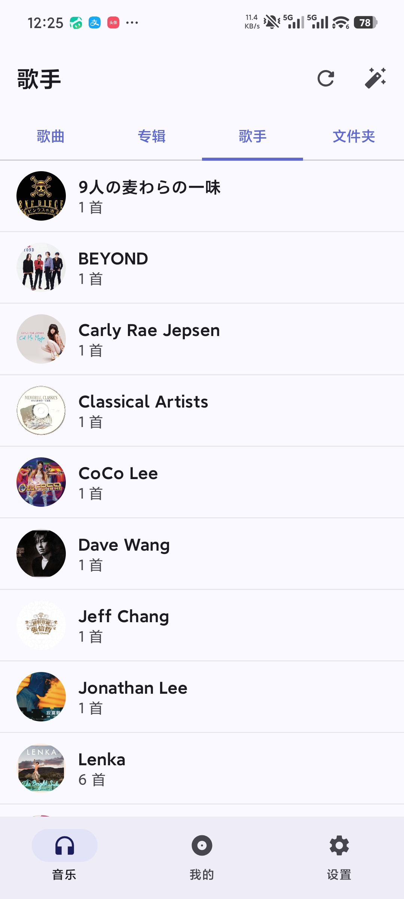
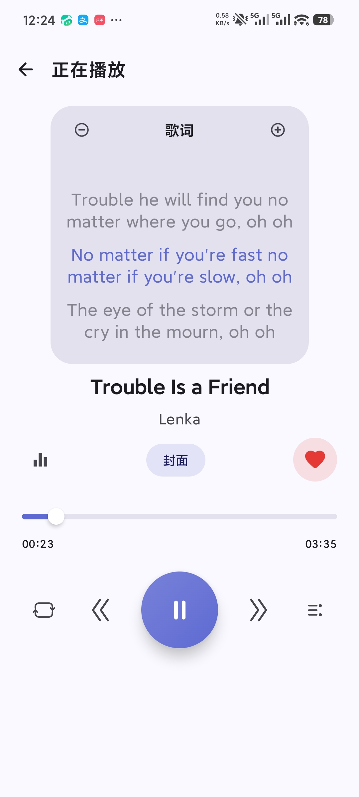
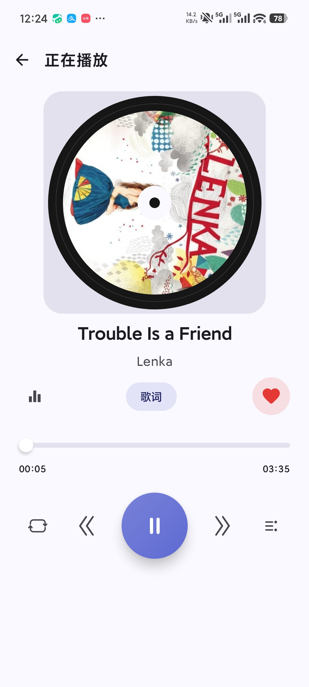
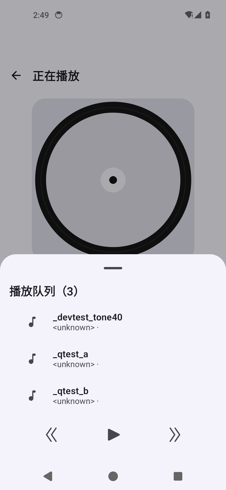
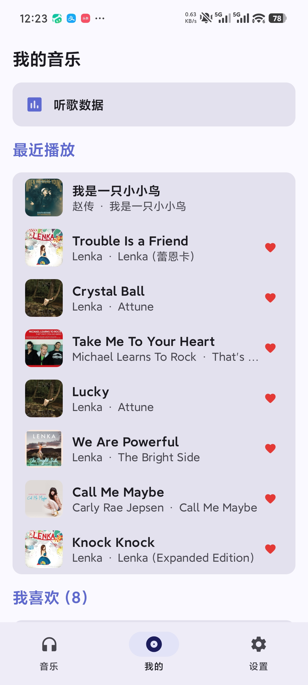
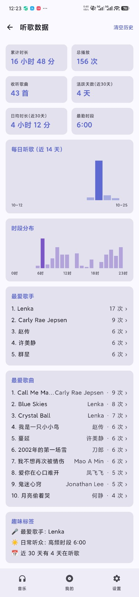
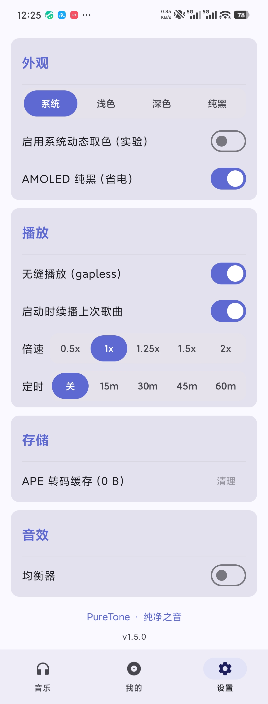

# PureTone 极简音乐播放器

> 一个基于 Jetpack Compose 的安卓本地音乐播放器，专注「好看、好听、轻量」。
> 自动扫描本地音乐，支持 3D 翻转歌词、APE/CUE 无损播放、联网补全元数据与歌词、均衡器、听歌统计等。

---

## 📸 界面预览

| 音乐库 · 歌曲 | 专辑网格 | 歌手列表 |
| --- | --- | --- |
|  |  |  |

| 播放页 · 歌词 | 播放页 · 封面 | 播放队列 |
| --- | --- | --- |
|  |  |  |

| 我的 | 听歌数据 | 设置 |
| --- | --- | --- |
|  |  |  |

---

## ✨ 功能特性

- **本地媒体扫描**：基于 `MediaStore` 自动扫描设备音乐，经 Room 持久化，支持按歌曲/专辑/歌手/文件夹多维浏览与排序。
- **音乐页四页签**：歌曲 / 专辑 / 歌手 / 文件夹一键切换；专辑页为方形封面**网格墙**，歌手为圆形头像列表，文件夹按目录聚合。
- **二级详情页**：专辑 / 歌手 / 文件夹均可进入详情页（封面 + 标题 + 首数 + 播放全部），列表项支持单击播放、长按操作菜单、加入歌单。
- **常驻迷你播放条**：仅保留「上一首 / 播放暂停 / 下一首」三枚按钮，左右对称，底部细进度线。
- **沉浸式播放页**
  - 封面 3D 翻转露出实时歌词；
  - 旋转 CD 唱盘；
  - 上滑/下滑手势切歌（tanh 阻尼视差过渡，松手过阈值续接归位）。
- **无损与冷门格式**：集成 ffmpeg-kit，支持 **APE / FLAC / WAV** 等格式，APE 在播放前自动转码为 WAV。
- **歌词与元数据**
  - 内置歌词解析（LRC / 内嵌歌词）；
  - 联网补全元数据（iTunes 接口）与下载歌词（LRCLIB）。
- **播放控制**
  - 顺序 / 随机 / 单曲循环三态循环；
  - 下一首播放、加入队列；
  - 收藏（红心），跨列表/播放页/迷你播放器实时同步（Room 实时派生真源）。
- **均衡器**：内置多档预设（平坦/流行/摇滚/爵士/古典/人声/低音），可开关。
- **ReplayGain 响度归一**：扫描曲库时自动用 ffprobe 提取 `REPLAYGAIN_TRACK_GAIN` / `REPLAYGAIN_ALBUM_GAIN`（MP3/AAC 取 ID3/APEv2 标签，FLAC/Ogg/Opus 取 Vorbis 注释），按曲目或专辑增益实时施加线性增益并做软限幅防削波；可调 preamp（−12~+12 dB）。
- **交叉淡化（Crossfade）**：双 ExoPlayer 实例「真重叠」——主播放器临近本曲结尾时提前起播备援播放器承载下一首，两路音量此消彼长；时长 0（默认，关）~ 12 秒可调。APE 等需转码格式在边界退化为无缝/曲间停顿。
- **听歌统计**：总播放量、收听歌曲数、累计时长与趋势；「最爱」仅统计**完整播放**的曲目。
- **桌面小部件**（Glance）：桌面播放控制条——封面 + 曲名/歌手 +「上一首 / 播放暂停 / 下一首」，整块点击进入 App。
  - 设置页「桌面」提供一键**添加到桌面**（`requestPinAppWidget`），无需在系统的小组件列表里翻找；
  - 配色跟随 App 主题（含 AMOLED 纯黑），更新由 App 在状态变化时主动推送（不轮询、不空转）；
  - 后台点击走 MediaSession 绑定通道拉起服务，绕开 Android 8+ 的后台启动限制。
- **睡眠定时（三模式）**：「关 / 播完本曲停止 / 自定义分钟」。
  - **播完本曲停止**：当前这首自然播完即暂停，不限时长（夜间听单张专辑最常用）；
  - **自定义分钟**：1 ~ 600 分钟任意值，另有 5/10/15/20/30/45/60/90 分钟常用档位；
  - 到期后（含到期瞬间被杀的残留）重启必然回到「关」，不会残留上次档位。
- **个性化**：倍速、睡眠定时（见上）、繁→简中文归一化、深色/浅色主题（含 AMOLED 纯黑模式）。
- **长按菜单**：曲库列表长按歌曲弹出操作浮层（下一首播放 / 加入队列 / 加入歌单 / 收藏 / 歌曲信息）。

---

## 🧱 技术栈

| 分类 | 技术 |
| --- | --- |
| 语言 | Kotlin 2.0.21 |
| UI | Jetpack Compose (BOM 2024.09.00) · Material 3 |
| 架构 | 单向数据流 · ViewModel + StateFlow · Hilt 依赖注入 |
| 播放 | AndroidX Media3 (ExoPlayer 1.4.1) + media3-session |
| 持久化 | Room 2.6.1 (KSP) · DataStore 1.1.1 |
| 图片 | Coil 2.7.0 |
| 音频处理 | ffmpeg-kit-min 6.0 LTS（本地 AAR，无损转码） |
| 构建 | AGP 8.5.2 · Gradle 8.7 · JDK 17 · compileSdk/targetSdk 34 · minSdk 26 |
| 测试 | Robolectric 4.12.2 · Turbine 1.1.0（单元回归全绿） |

---

## 📂 项目结构

```
app/src/main/java/com/puretone/player/
├── data/                 # 数据层
│   ├── local/            # Room 实体 / DAO / 数据库
│   ├── media/            # MediaStore 扫描
│   ├── metadata/         # iTunes 元数据补全
│   ├── playlist/         # 歌单
│   ├── repository/       # 仓储（唯一数据真源）
│   └── settings/         # 设置偏好
├── di/                   # Hilt 模块
├── effect/               # 视觉/音频效果
├── lyrics/               # 歌词解析与下载
├── playback/             # ExoPlayer 封装、队列、PlaybackManager
├── ui/
│   ├── components/       # 复用组件（SongRow / 控制图标 / 迷你播放器）
│   ├── screens/          # 各页面（音乐库 / 播放 / 我的 / 统计 / 设置）
│   ├── theme/            # 主题与配色
│   └── permission/       # 运行时权限引导
└── util/                 # 工具（中文归一化、文件等）
```

---

## 🛠 构建与运行

### 环境要求

- **JDK 17**
- **Android SDK**（compileSdk 34），在 `local.properties` 设置 `sdk.dir`
- **Gradle 8.7**（使用仓库自带 `gradlew`，无需单独安装）

### 调试构建（无需签名）

```bash
./gradlew assembleDebug
# 产物：app/build/outputs/apk/debug/app-debug.apk
```

### 发布构建（需自备签名）

仓库已配置 `signingConfig`，密钥通过 `local.properties` 读取（该文件与 `*.jks` 均已 gitignore，**不会入库**）。
在 `local.properties` 中填入：

```properties
storeFile=keystore/puretone-release.jks
storePassword=你的密钥库口令
keyAlias=puretone
keyPassword=你的密钥口令
```

然后构建：

```bash
./gradlew assembleRelease
# 产物：app/build/outputs/apk/release/PureTone-v1.5.0-universal-release.apk
#       app/build/outputs/apk/release/PureTone-v1.5.0-arm64-v8a-release.apk
```

> `dist/` 目录存放各版本已签名的发布包与交付证据（SHA-256 / apksigner 校验记录）。

### 关于 ffmpeg-kit 依赖

`app/libs/ffmpeg-kit-min-6.0-2.LTS.aar` 为本地 AAR（无公网 Maven 坐标），**已随仓库提交**，
构建时由 `app/build.gradle.kts` 通过 `libs` 目录直接引用，无需联网下载。

---

## 🔌 扩展点

| 扩展 | 说明 |
| --- | --- |
| **元数据补全** | `data/metadata/` 调用 iTunes 接口补全专辑/歌手/封面，可替换数据源。 |
| **歌词下载** | `lyrics/` 通过 LRCLIB 下载 LRC，可接入其他歌词源。 |
| **歌单导入/导出** | 数据层已支持歌单实体，可扩展 M3U 等格式互导。 |
| **均衡器预设** | `ui/screens` 均衡器页预设集中在 `presetLabel()`，新增预设即加一行。 |
| **无损转码** | `playback` 中 ffmpeg-kit 负责 APE→WAV，可扩展更多格式。 |
| **桌面小部件** | `widget/` 下 `PureToneWidget` 输出 UI、`WidgetStateProvider` 提供内容与配色，更新入口统一收敛到 `WidgetUpdater`。 |

---

## 📝 版本历史

| 版本 | 要点 |
| --- | --- |
| v1.1.0 | 播放页四按钮重构、封面 3D 翻转歌词、tanh 阻尼视差切歌、浏览排序、iTunes 元数据、听歌统计看板 |
| v1.1.1 | 倍速/定时选中态、歌曲信息自动填充 + LRCLIB 歌词、封面补全迁移、列表去冗余按钮 |
| v1.1.2 | 设置页排版重构、切歌手势改为上滑/下滑 |
| v1.1.3 | 音乐页「播放全部」、听歌统计→听歌数据、均衡器开关、歌曲编辑实时更新 |
| v1.1.4 | ControlIcons 自绘线形图标、旋转 CD 唱盘、播放全部 FilledTonalButton |
| v1.1.5 | 队列图标、均衡器中文预设、仅完整播放计最爱、繁→简归一化、胶囊输入框 |
| v1.1.8 | 三态循环、红心收藏、移除多余状态色 |
| v1.1.9 | 列表 `key` 防串位、长按操作菜单、收藏跨入口实时同步（Room 派生真源） |
| v1.2.0 | 播放队列浮层精简、循环图标圆角重设计、播放卡片新增「播放顺序/喜欢」对称按钮、切换按钮中性化 |
| v1.3.0 | 迷你播放条精简为三按钮；音乐页新增 歌曲/专辑/歌手/文件夹 四页签；专辑方形封面网格墙；专辑/歌手/文件夹二级详情页 |
| v1.3.1 | 首轮代码审查（CODE_REVIEW）P0~P3 全量修复 |
| v1.3.2 | 修复「进播放页被自动暂停」；SQL 批量参数分片等崩溃防护 |
| v1.4.0 | 第二轮代码审查全量修复：统计虚高、APE 转码期队列竞态、MediaSession 准入白名单、睡眠定时墙钟基准等 |
| v1.4.1 | 歌词高亮居中悬浮；设置页子项高度统一；听歌数据页配色对齐 |
| v1.5.0 | 第三轮复审按序修复：主题行高度统一、续播恢复竞态、APE 锁原子化、均衡器主开关语义、Room v5 索引迁移、封面占位 URI 清理等 |
| v1.6.0 | 桌面小部件（Glance 播放控制条 + 一键添加到桌面 + 后台点击走 MediaSession 通道）；睡眠定时细粒度（播完本曲停止 + 自定义分钟 1~600m，四字段统一归一化）；统计与元数据逻辑下沉 `domain` 用例层 |

---

## 📄 许可证

本项目以 **MIT License** 开源。详见 [LICENSE](LICENSE)（如未包含可补）。

---

*PureTone 持续迭代中，欢迎 Issue 与 PR。*
